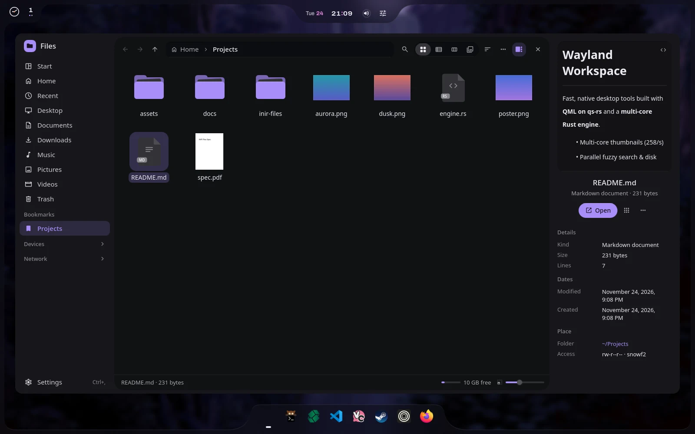
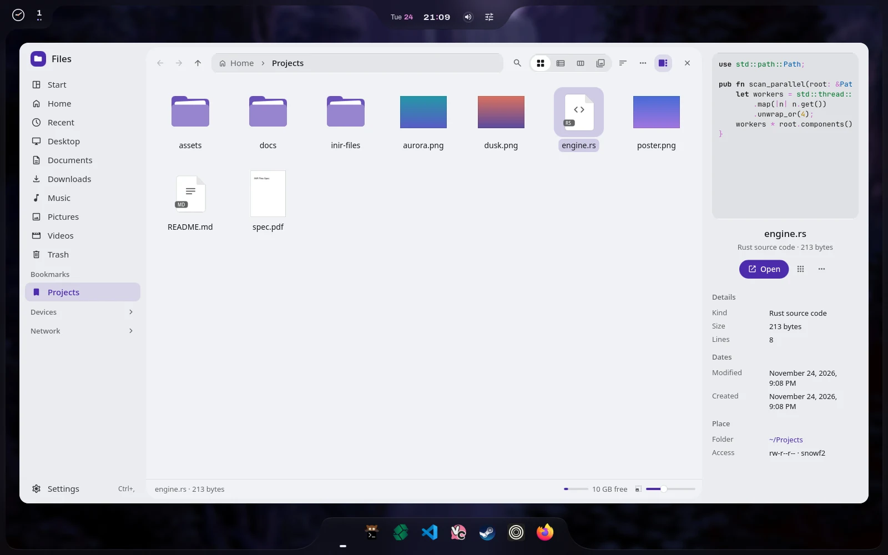
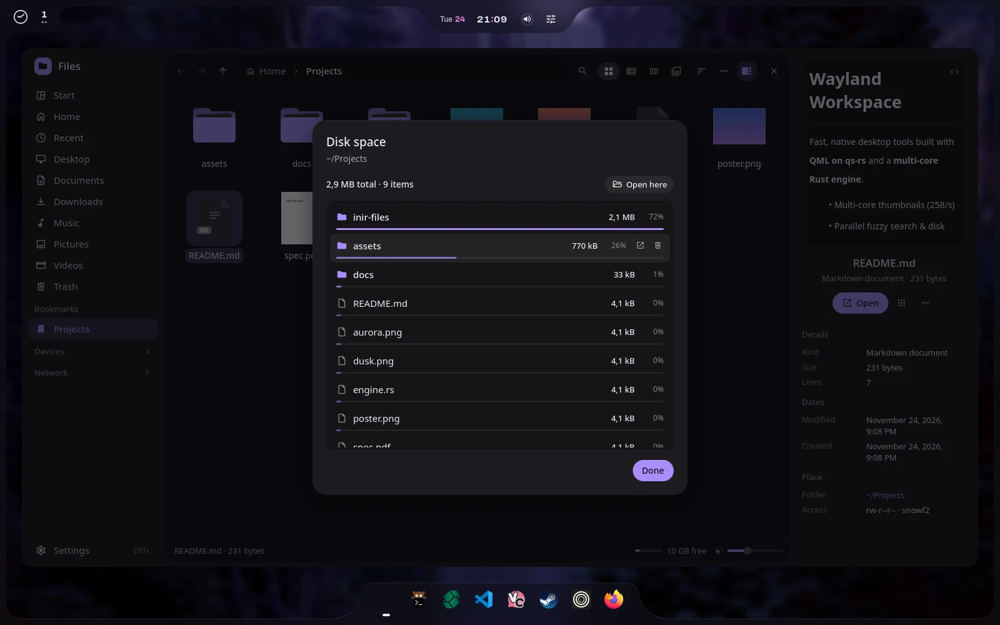

# iNiR Files

The native file manager of the **iNiR** desktop ecosystem. Built in QML on **qs-rs** (the iNiR runtime) over a multi-core Rust engine (`inir-files-core`).



<details>
<summary>Light mode & built-in Disk Space Analyzer</summary>




</details>

---

## Who it is for

- **iNiR users on Niri and Umbriel** who want a file manager that matches their desktop's palette, fonts, corners and motion without dragging in GTK or KDE theming mismatches.
- **Tiling-WM & keyboard-first users** who split, detach tabs into tiled windows, jump with a command palette (`Ctrl+K`), and filter folders in memory (`Ctrl+/`).
- **Media & code folders** that need fast thumbnails, a full-bleed photo gallery (`Ctrl+4`), Miller columns (`Ctrl+3`), rich previews (Markdown, code, PDF, video, audio, EXIF/HDR metadata) and an instant disk-space lens (`Ctrl+Shift+U`).

## Relation to iNiR

iNiR Files is a companion app of [iNiR](https://inir.space), not a hard-coupled shell panel:

- **Live visual sync:** Watches iNiR's generated `app-palette.json`, `app-look.json` and `theme-meta.json` (and falls back cleanly to neutral graphite + blue accent when run without iNiR). Scheme, wallpaper tint strength, font family, title/mono fonts, scale and corner rounding update live with zero restart.
- **Wallpaper integration:** Sets any image or video directly as the desktop wallpaper over iNiR's IPC.
- **Shared runtime:** Runs exclusively on `qs-rs`, the iNiR QML runtime, and serves `org.freedesktop.FileManager1` on D-Bus so browsers and desktop apps open "Show in folder" directly in iNiR Files.

## Aesthetic & design principles

- **Tonal hierarchy, not bordered card soup:** Three calm planes (`rail` → `canvas` → `aside`), elevated sheets/menus (`raised`) with a 1 px top light edge, and restrained whitespace instead of outlines around every control.
- **Crisp interaction:** Solid hover/press surface tokens (`cardHover` / `cardPress`) with 65 ms transitions so fast pointer sweeps never flicker or leave trailing smears.
- **Adapts to tiling layouts:** Narrow half-screen Niri/Umbriel tiles collapse the 4-view pill into a 1-click view switcher (never burying view switching), clamp the preview pane automatically, and let you drag-resize the left sidebar, preview aside, split divider and Miller columns (double-click any seam to reset).
- **Calm, customizable Start page:** Wallpaper fades softly into the canvas; shows only real system utility (system folders, storage bars, recent files hidden when empty) and lets you toggle any section live from the top-right customize menu.

## How it works

```
┌──────────────────────────────────────────────────────────┐
│  QML UI on qs-rs (single process, multi-window, IPC)     │
│  ├─ Per-key reactive Prefs & per-pane live zoom/filter   │
│  ├─ Bucket-aligned GPU thumbnails (128/256/512/1024 px)  │
│  └─ Views: Start, Grid, List, Columns, Gallery, Split    │
└───────────────────────────┬──────────────────────────────┘
                            │ line-delimited JSONL (stdin/stdout)
┌───────────────────────────▼──────────────────────────────┐
│  inir-files-core (Rust, multi-core worker pools)         │
│  ├─ Listing, inotify watch, freedesktop thumbnails       │
│  ├─ Parallel fuzzy search + ripgrep content search       │
│  ├─ Parallel same-fs disk space analyzer (space_map)     │
│  ├─ Jobs (copy/move/trash/archives) + conflict prompts   │
│  ├─ GVfs remote mounts (sftp, smb, ftp, webdav, nfs)     │
│  └─ D-Bus org.freedesktop.FileManager1 service           │
└──────────────────────────────────────────────────────────┘
```

One `qs` process hosts every open window; launching `inir-files PATH` hands paths to the running instance over IPC. All disk I/O, recursive walks, thumbnail generation, media probing, Markdown rendering and file jobs run off the UI thread in Rust.

## Speed & comparison

Measured locally on Linux (x86_64):

| Workload | Result |
|---|---|
| Thumbnails (1,000 JPEG + 200 PNG + 30 MP4) | **258 / s**; first 60 ready in **164 ms** (**12–20 ms** with EXIF thumb) |
| Parallel fuzzy name search (`hpq` → `HomePane.qml`) | **6 ms** across 1,230 entries (multi-core work-stealing) |
| Parallel disk space scan (`space_map`, 534 MB / 35 subtrees) | **291 ms** streamed live |
| Miller columns reuse (24 navigation steps) | **507** delegates created (down from 1,831); cached revisit instant |
| In-folder fuzzy filter (`Ctrl+/`) & Command Palette (`Ctrl+K`) | **< 1 ms** (in-memory, zero disk I/O) |
| Memory (single process, active window + preview) | **~240–310 MB** RSS shared across windows |

### Honest comparison

| Capability | iNiR Files | Dolphin | Nautilus | Thunar |
|---|---|---|---|---|
| Live iNiR palette / fonts / rounding sync | Native | Manual theme | Manual theme | Manual theme |
| Tiling-WM tab tear-off & split-pane detach | Built-in | Partial | Partial | No |
| Command & Jump Palette (`Ctrl+K`) | Built-in | No | No | No |
| Built-in multi-core Disk Space Analyzer | Built-in | Via Filelight | Via Baobab | No |
| Miller Columns + Full-bleed Gallery (`Ctrl+3`/`4`) | Built-in | No | No | No |
| Quick Look (`Space`: PDF, MD, code, media, fonts) | Built-in | Limited | Via Sushi | No |
| Per-folder view memory | Built-in | Built-in | No | No |
| Startup RAM footprint | ~240–310 MB (Qt/QML) | ~90–140 MB | ~70–110 MB | ~35–55 MB |
| Plugin / third-party extension ecosystem | Minimal by design | Extensive | Extensions | Plugins |

## Key features & shortcuts

| Shortcut | Action |
|---|---|
| `Ctrl+K` / `Ctrl+P` | Command & Jump Palette (`Enter` open, `Ctrl+Enter` new tab, `Alt+Enter` new tiled window) |
| `Ctrl+/` | Instant in-folder fuzzy filter (zero disk I/O) |
| `Ctrl+F` | Parallel recursive search by name or file contents (`ripgrep`) |
| `Ctrl+Shift+U` | Multi-core Disk Space Analyzer with drill-down and trash |
| `Ctrl+1` / `2` / `3` / `4` | Grid, List, Miller Columns, full-bleed Gallery (remembered per folder) |
| `Space` | Full-window Quick Look (`PageDown`/`PageUp` for PDF pages) |
| `F3` | Split view (detach either side into a new window from its header) |
| `Ctrl+T` / `Ctrl+Shift+D` / `Ctrl+Alt+W` | New tab, duplicate tab, detach tab to new tiled window (or drag tab vertically) |
| `Ctrl+Shift+PgUp` / `PgDown` | Reorder tabs by keyboard |
| `Ctrl+Scroll` / `Ctrl+=` / `-` / `0` | Per-pane zoom (never stalls other windows) |
| `F2` / `Ctrl+S` | Inline rename (single) or batch rename sheet (multi); select by pattern |
| `Ctrl+Z` / `Ctrl+Shift+Z` | Multi-step Undo / Redo for copy, move, rename, new item, trash |
| `F9` / `Ctrl+I` / `Ctrl+,` | Toggle Places sidebar, Preview aside, Settings |

## Limitations

- **Requires `qs-rs`:** Does not run on stock upstream Quickshell; requires `qs-rs` (shipped with iNiR).
- **Wayland-first:** Designed for Wayland compositors (Niri, Umbriel and wlroots/Smithay compositors); X11 is unsupported.
- **Qt/QML memory floor:** Because it renders on Qt Quick (`qs-rs`), baseline RSS (~240–310 MB for the shared process) is higher than pure-GTK/C managers like Thunar.
- **Optional external tools for exotic formats:** AVIF, HEIC, JPEG XL, RAW images and PDF rendering rely on `magick` (ImageMagick) and `pdftoppm`/`pdfinfo` (poppler) when present, until `kimageformats` / `QtPdf` are bundled in `qs-rs`.
- **Remote mounts & secrets:** SFTP/SMB/FTP/WebDAV/NFS connections require `gio` and `gvfsd-fuse`; password storage depends on the desktop keyring.
- **Hardware gestures:** Touchpad swipe and long-press touch menus are implemented and tested synthetically, not yet tuned across all laptop touchpads.

## Install, update & build

### On iNiR (automatic, no commands needed)

iNiR delivers and updates iNiR Files automatically via `inir update` (and `inir setup extras`). To make it your system-wide default file manager (including browser "Show in folder" links), flip **Settings → Default file manager** inside the app.

### Standalone (prebuilt release, x86_64 & aarch64)

```sh
curl -fsSL https://raw.githubusercontent.com/snowarch/inir-files/main/install.sh | bash
```

Pass `--default` to also register it as the default folder handler and `org.freedesktop.FileManager1` service. Re-run the same command anytime to update atomically (or let `inir update` manage it).

### From source

```sh
# Build & run from checkout
make build
bin/inir-files [PATH]...

# Install for your user (no root needed)
make install PREFIX="$HOME/.local"

# Package a self-contained release tarball + SHA-256
make dist

# Run tests & QML check
make test
qs check -p shell.qml
```

`make install` installs the launcher (`$(PREFIX)/bin/inir-files`), Rust engine (`$(PREFIX)/libexec/inir-files-core`), QML app (`$(PREFIX)/share/inir-files/`), `.desktop` entry, and D-Bus `org.freedesktop.FileManager1` service with `Exec=` rewritten to `$(BINDIR)/inir-files --service`. Standard `DESTDIR` is supported.

## Optional tools used when present

| Tool | Used for |
|---|---|
| `ffmpeg`, `ffprobe` or `ffmpegthumbnailer` | Video thumbnails and stream metadata (including HDR10/HLG/Dolby Vision) |
| `pdftoppm`, `pdfinfo` (poppler) | PDF page previews and document facts |
| `magick` (ImageMagick) | AVIF, HEIC, JPEG XL and camera RAW previews |
| `rg` (ripgrep) | Fast search inside file contents |
| `7z`, `bsdtar` | Archive inspection, compression (zip, 7z, tar.zst/xz/gz) and extraction |
| `udisksctl`, `gio` | Disk mounting/ejection and GVfs remote servers |
| `wl-copy`, `wl-paste` | Wayland clipboard integration |

## License

GPL-3.0-or-later. See `LICENSE`.
